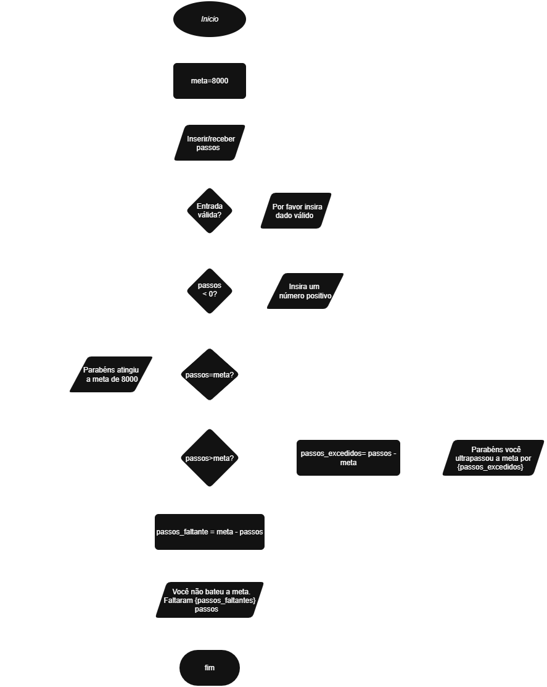

# 🏃 Desafio #03 — Meta de Passos

**Comunidade:** Tech Sisters  
**Linguagem:** Python  
**Nível:** Iniciante

## 🎯 Objetivo

Desenvolver um programa que receba a quantidade de passos realizados durante o dia e compare esse valor com uma meta de 8.000 passos.

O programa deve informar se a meta foi atingida, ultrapassada ou não atingida, apresentando a diferença de passos quando necessário.

## 🧠 Conceitos praticados

- Variáveis e tipos de dados
- Entrada e saída de dados (`input()` e `print()`)
- Estruturas condicionais (`if`, `elif`, `else`)
- Operadores de comparação e aritméticos
- Ciclo `while`
- Tratamento de exceções com `try/except`
- Validação de dados
- Construção de fluxogramas

## 💻 Desenvolvimento e evolução da solução

### 1. Primeira implementação

Comecei por desenvolver uma solução utilizando estruturas condicionais para comparar a quantidade de passos com a meta.

Esta primeira versão cumpria os requisitos funcionais do desafio, mas ainda não tinha validação das entradas.

**Limitações identificadas:**
- Se o utilizador introduzisse texto em vez de um número inteiro, ocorreria um `ValueError`.
- O programa aceitava valores negativos, embora não representassem uma quantidade válida de passos.

### 2. Melhorias após a revisão

Depois de concluir a primeira implementação, utilizei uma ferramenta de IA para analisar o meu código e identificar possíveis melhorias, sem solicitar uma solução pronta.

A partir das sugestões, procurei compreender os conceitos necessários e implementá-los autonomamente.

Acrescentei:

- `try/except ValueError` para tratar erros de conversão.
- Uma condição `if` para rejeitar números negativos.
- `while True` para permitir novas tentativas quando a entrada fosse inválida.
- `break` para terminar o ciclo após o processamento de uma entrada válida.

Durante esta etapa, cometi um erro ao colocar o `break` apenas na condição em que os passos eram inferiores à meta.

Isso fazia com que o programa continuasse a pedir valores mesmo depois de o utilizador atingir ou ultrapassar a meta.

Depois de compreender o problema, corrigi a posição dos `break`, garantindo que o programa terminava nos três casos válidos.

## 🔀 Fluxograma

Este foi o primeiro desafio em que decidi criar um fluxograma para representar a lógica do programa.

Embora já tivesse utilizado fluxogramas anteriormente, estava há algum tempo sem os praticar.

Na primeira versão, cometi erros na escolha dos símbolos e não representei a validação dos dados nem a repetição da entrada.

Procurei identificar e corrigir essas falhas autonomamente, criando uma segunda versão mais completa.

**Fluxograma atualizado:**

## 📚 O que aprendi

**1. Tratamento de exceções**

Em Python, `try/except` permite tratar determinados erros durante a execução do programa. Neste desafio, utilizei `except ValueError` para lidar com entradas que não podiam ser convertidas para números inteiros.

**2. Ciclos de repetição**

`while True` permite executar repetidamente um bloco de código. Como a condição é sempre verdadeira, é necessário definir quando interromper o ciclo.

Aprendi que `break` termina o ciclo e que, quando a execução chega ao fim de uma iteração sem encontrar um `break`, o ciclo volta a executar-se.

**3. Validação de dados**

Percebi que um valor pode ser válido para a linguagem, mas inadequado para o problema.

Por exemplo, `-5` é um número inteiro, mas não representa uma quantidade válida de passos realizados.

**4. Planeamento com fluxogramas**

Reforcei a importância de representar a lógica do algoritmo antes de começar a programar.

Também pratiquei a utilização dos símbolos adequados para decisões, processamento, entradas e saídas de dados.

## 🤖 Utilização de IA no processo de aprendizagem

Utilizei o ChatGPT como apoio à aprendizagem, principalmente para:

- Analisar a solução que desenvolvi.
- Identificar possíveis erros e melhorias.
- Compreender conceitos que ainda não dominava.
- Esclarecer dúvidas através de exemplos diferentes do desafio.

A implementação e as alterações ao código foram realizadas por mim, procurando compreender cada decisão em vez de simplesmente copiar uma solução.

## ✅ Resultado

O programa final cumpre os critérios propostos e inclui validações adicionais para tornar a interação mais robusta.

Este desafio ajudou-me a consolidar as estruturas condicionais e a compreender melhor a relação entre validação de dados, tratamento de exceções e ciclos de repetição.